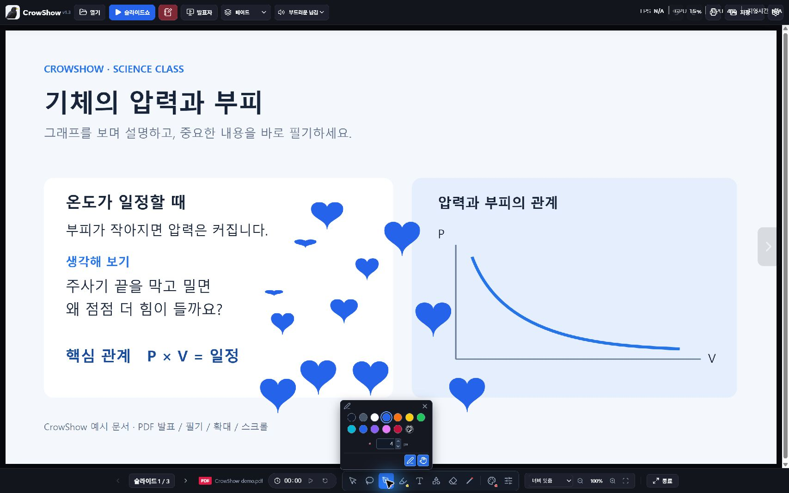
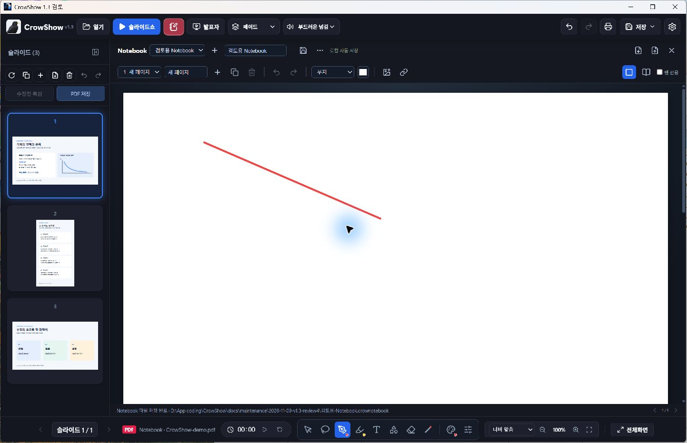
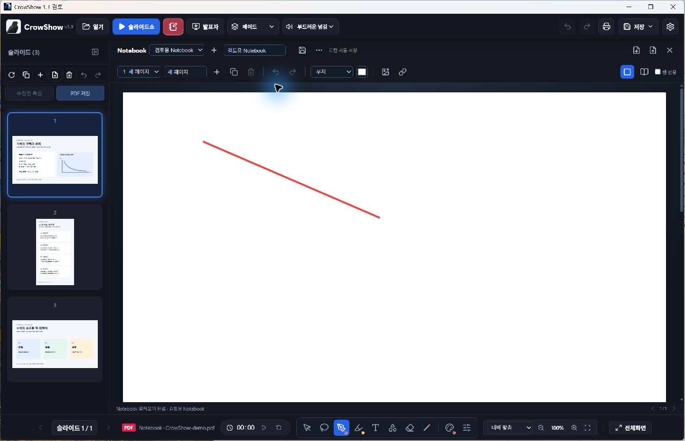
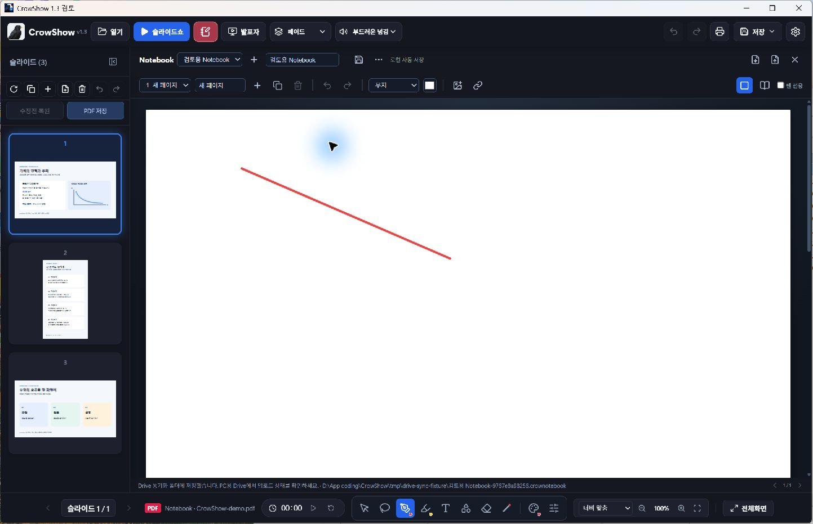
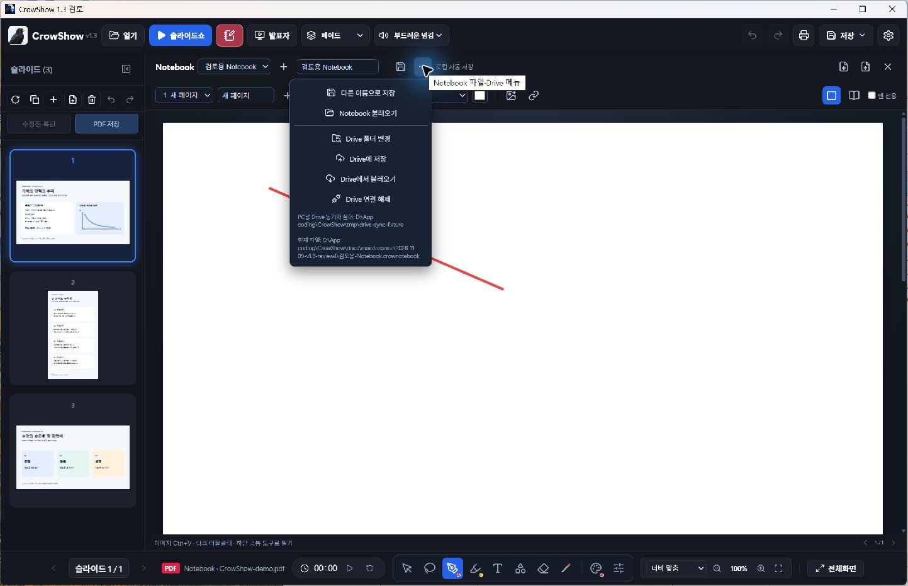

# CrowShow 1.3 Review4 검토 보고서

날짜: 2026-11-09 · PC 프로젝트: D:\App coding\CrowShow

**로컬 검토용. GitHub push/release, Microsoft Store 업로드·제출 없음.** 기존 Review1~3 변경을 유지하고 다음 7개 요청을 반영했습니다.

## 요청과 결과

| 요청 | 수정 결과 | 검증 |
|---|---|---|
| 발표 하위 메뉴 | 발표 컨테이너 내부에 공통 ToolDock 팝업을 배치 | 실제 F5 발표에서 펜 설정 표시, 01-slideshow-popup.png |
| 화면 레이저 | 원통은 아이콘에만 남기고 화면에는 글로우 점만 투사 | 실제 화면 02-laser-dot.png, 렌더러 본체 선 0개·점 1개 검사 |
| 잔상 항상 사용 | 켜기/끄기 항목 삭제, 항상 잔상 축적, 100~5000ms 시간만 조절 | 설정/렌더 경로 및 회귀 검사 |
| 더 작은 하위 메뉴 | 폭 248→200px, 버튼·아이콘·팔레트·입력칸 간격 축소 | 동일 공통 컴포넌트, 실제 발표 화면 |
| PDF 너비 100% | 너비 맞춤 스케일을 기준 1로 환산, 새 PDF도 너비 맞춤 시작 | 실제 상태바 100%, 기존 0.91875 결과→1 회귀 검사 |
| 페이지 넘김 소리 | 표시된 전환음 선택값을 기준으로 음소거 동기화, 입력 시 오디오 활성화, 실제 페이지 변경에서 한 번 호출 | 이전 음소거 false 상태에서도 soft 발진기 시작 검사. 물리 스피커 청음은 미검증 |
| 독립 Notebook/Drive | .crownotebook 저장/다른 이름/불러오기, PC용 Drive 폴더 연결/저장/불러오기/해제 | 실제 Windows 파일·폴더 대화상자, 붉은 필기 유지, 03~06 이미지. 실제 Drive 서버는 미검증 |

## 원인

발표 컨테이너 z-index 9999보다 낮은 body 팝업 z-index 450이 뒤에 가려졌습니다. 공통 팝업의 portal 대상을 발표 컨테이너로 변경했습니다.

PDF 배율은 물리 크기 대비 비율을 그대로 표시해 너비 맞춤이 91% 등으로 표시됐습니다. 너비 맞춤을 기준으로 실제 렌더 크기와 표시 비율을 함께 계산합니다. 페이지 맞춤은 높이를 추가 고려하므로 다른 값입니다.

전환음은 화면에 소리를 선택해도 별도 레거시 음소거 저장값이 false이면 조용히 종료했습니다. 전환음 선택값을 기준으로 삼고, 브라우저 오디오 컨텍스트 활성화와 페이지 변경 재생을 연결했습니다.

## 파일과 보존

- .crownotebook은 format=crowshow-notebook, version=1, savedAt, book을 가진 JSON 파일입니다. 노트 하나의 페이지·필기·이미지·보기 설정을 담고 슬라이드 PDF는 포함하지 않습니다. 브라우저에서는 다운로드/파일 선택으로 사용하고 Drive 폴더 기능은 Windows PC에서만 제공합니다.
- 파일명·확장자·절대 경로 및 128MB 제한 검증. 파일 해시를 노트 사본+경로별로 기억합니다. 먼저 저장한 다른 사본/외부 변경을 발견하면 저장을 중단합니다. 명시적인 다른 이름 저장의 교체는 Windows 확인을 거칩니다.
- 기존 파일은 앱 설정 폴더 notebook-backups에 SHA-256 이름으로 백업한 뒤 같은 폴더의 임시 파일을 교체합니다. 파일 연결 설정은 notebook-files.json에 보관합니다.
- Drive는 사용자가 지정한 PC용 Drive 폴더에 저장하는 방식입니다. 서버 업로드·다운로드와 충돌 복제본 처리는 PC용 Drive의 역할입니다. 자동 병합/서버 완료 감지 기능은 없습니다.
- 기존 노트를 유지하고 검토용 Notebook을 별도로 만들어 테스트했습니다. 샘플 검토용-Notebook.crownotebook은 한 페이지와 붉은 필기 1개를 담습니다. 로컬 시험 Drive 폴더는 저장·불러오기 후 연결 해제했습니다.

## 검증 기록

수정 전 node scripts/review4-regression.cjs 결과: 너비 맞춤 0.91875!=1, 기존 음소거로 soft 재생 차단, 발표 팝업 body 배치의 세 항목 실패. 수정 후 5항목 모두 통과했습니다.

- node scripts/review4-regression.cjs: 너비 맞춤, 음소거 충돌, 발표 팝업, 레이저 점, 독립 노트 형식/필기 왕복 통과.
- 기존 review3-notebook.cjs, review3-selection.cjs, v13-data.cjs, toolbar-notebook-data.cjs 통과.
- npm run lint, npm run build 통과.
- cargo test --offline: 4 passed. 파일 왕복/백업/외부 변경 차단, 동일 파일을 연 두 노트의 오래된 사본 덮어쓰기 차단, 이름/형식, 기존 업데이트 검사 포함.
- npm run tauri:build -- --config src-tauri/tauri.review.conf.json: Windows x64 EXE/NSIS 검토판 제작. 검토판 식별자를 사용해 정식 설치판 저장소와 분리합니다.
- 일반 설정의 최초 NSIS 시도는 도구 다운로드 DNS 실패. 검토 설정의 로컬 도구 실행도 샌드박스의 Windows 오류 623으로 한 번 실패해, 동일 명령을 승인된 샌드박스 밖 빌드로 완료했습니다. 기존 큰 청크/링커 안내는 실행 차단 오류가 아닙니다.
- 최종 배포 폴더 EXE를 재실행해 PDF 너비 맞춤 100%, Notebook 필기 유지, 파일 불러오기와 다시 저장 성공을 확인했습니다. 최종 실행 파일 해시는 빌드 산출물과 일치합니다. 07-final-build-save.png에 최종 저장 결과를 보존했습니다.
- 설치 파일의 실제 설치/삭제, 실제 Drive 서버 동기화, 물리 스피커 청음은 미검증입니다. 기존 검토판과 같은 미서명 로컬 검토용입니다.

## 화면 증거

## Windows 대화상자 근거

Windows 기본 저장·열기·폴더 선택 API를 사용하며 외부 셸/콘솔 창을 실행하지 않습니다. 근거: Microsoft [OPENFILENAMEW](https://learn.microsoft.com/en-us/windows/win32/api/commdlg/ns-commdlg-openfilenamew), [GetSaveFileNameW](https://learn.microsoft.com/en-us/windows/win32/api/commdlg/nf-commdlg-getsavefilenamew), [BROWSEINFOW](https://learn.microsoft.com/en-us/windows/win32/api/shlobj_core/ns-shlobj_core-browseinfow), [SHBrowseForFolderW](https://learn.microsoft.com/en-us/windows/win32/api/shlobj_core/nf-shlobj_core-shbrowseforfolderw).

## 검토 파일

- release/CrowShow-v1.3-Review4-x64.exe
- release/CrowShow-v1.3-Review4-Setup-x64.exe
- release/CrowShow-v1.3-Review4-SHA256SUMS.txt
- USER_GUIDE.md의 Review4 항목이 현행 사용법입니다.
