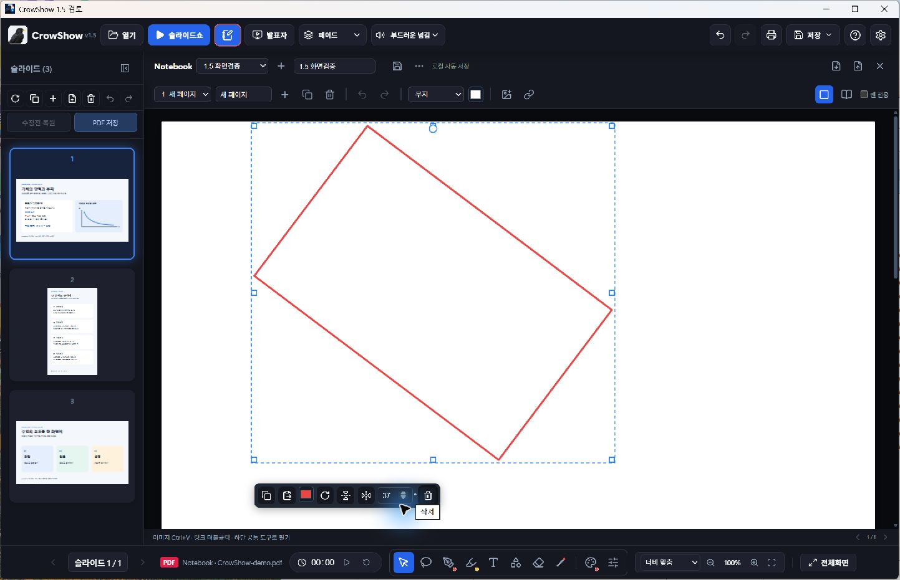
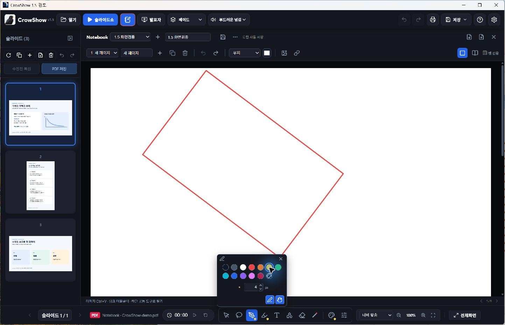
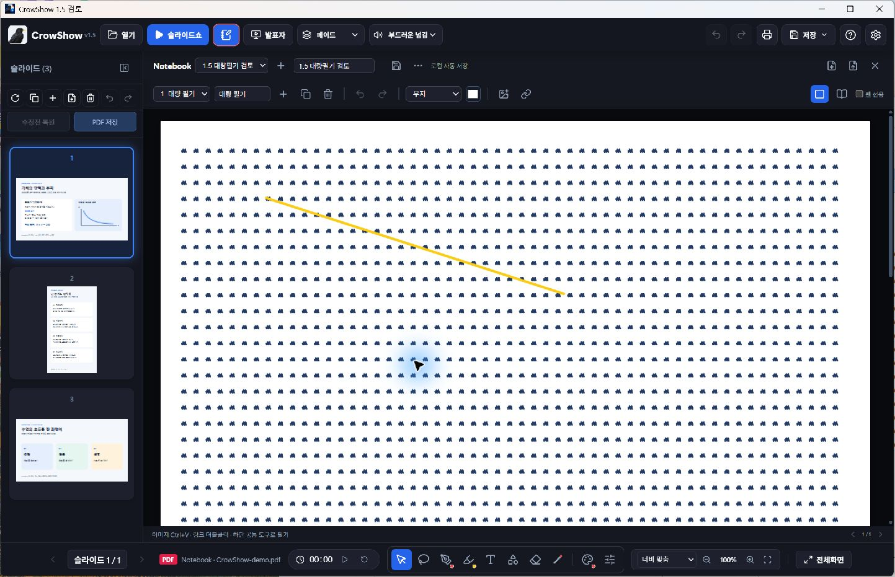

# CrowShow 1.5 로컬 검토 보고서

작성: 2026-11-10 · 프로젝트: D:\App coding\CrowShow

**GitHub push/release, Microsoft Store 업로드·제출 없음.** 사용자 검토 후 배포를 결정합니다.

## 요청별 구현

| 항목 | 반영 내용 | 확인 범위 |
|---|---|---|
| 1 도형 크기·회전 | 8개 핸들로 가로/세로/모서리 자유 조절, Shift 비율 유지. 상단 회전 핸들을 도구 메뉴와 겹치지 않게 배치하고 각도 직접 입력 추가 | 실제 너비만/높이만 드래그, 핸들 자유 회전 48도 및 숫자 37도 입력 확인. 05-transform.png |
| 2 색상 유지 | 공통 aria-pressed 파란 배경 적용에서 color-chip 제외. 기존 선택 원형 링 유지 | 실제 펜 팔레트의 선택한 빨강/노랑 원색과 원형 링 확인. 06-palette.png |
| 3 필기 지연·저장 오류 | 전체 deep clone·JSON 비교·동기 저장 제거, 공유 undo 40단계, IndexedDB 비동기 저장, 활성 노트 중복 제거, 노트 보조 저장 중단, 획 입력 중 기존 그림 캐시 | 50만 점 편집 재현·저장 이전/실패/복구·실제 포인터 렌더 경로 자동 검사 |
| 4 인쇄 옵션 | 왼쪽 178px 옵션 패널에 범위/장수/필기/방향/실행 배치, 넓은 오른쪽 미리보기 | 실제 Ctrl+P 미리보기 표시 확인. 04-print.png. 물리 프린터 출력 미검증 |
| 5 마지막 페이지 삭제 | 한 장도 삭제 허용, 같은 용지/배경색·새 ID의 빈 페이지 생성, 필기/배경 이미지 제거. 기존 페이지 실행 취소 유지 | 실제 검증용 노트 한 장 삭제→빈 한 장 유지→페이지 실행 취소로 도형 복구 확인. 자동 번호 재배치 검사 |
| 6 버전 | 표시 1.5, 앱·Cargo·프로젝트 1.5.0, Store 1.5.0.0 | 매니페스트 및 빌드 산출물 |
| 7 테마 | Dark/Light/Pink/Blue. 기본 Dark, Pink/Blue는 밝은 배경. 이전 System은 Dark로 이전 | 실제 환경 설정에서 4종 전환 확인, Dark로 복귀. 02-pink.png·03-blue.png |
| 8 도움말 | 시작·편집 상단 ? 버튼 및 F1, 기능·단축키 상세 창, Esc/X/바깥 클릭 및 포커스 복귀 | 실제 ? 클릭으로 상세 창 표시 및 Esc 닫기 확인. 01-help.png. F1은 이 PC의 Snipaste 전역 단축키와 충돌 |
| 9 시작 시 업데이트 | GitHub 기존 시작 검사 및 중복 검사 방지, Store 전용 검사/설치 API 추가. 새 버전 확인 후 사용자 동의와 자동 저장 완료를 거쳐 다운로드·설치 | Rust 업데이트 버전/체크섬 검사, Store feature 컴파일. 서버 실제 업데이트 미검증 |
| 10 검토 후 배포 | 로컬 검토용 EXE·NSIS·체크섬 제작. Store 매니페스트만 갱신 | 업로드/제출/릴리스/태그 미실행 |

## 필기 원인과 성능 근거

글씨는 글자 단위 이미지가 아니라 획의 좌표·압력·기울기 정보로 보관합니다. 점이 늘수록 자원 사용은 증가하지만, 이전 구조가 그 비용을 크게 증폭했습니다.

1. AnnotationStore가 실행 취소에 전체 문서를 deep clone하고 트랜잭션 종료 때 전체 JSON을 비교했습니다.
2. 획마다 전체 필기를 localStorage에 동기 JSON 저장했습니다. Notebook 자체의 활성 페이지 필드·books 필드 및 노트별 보조 저장이 중복됐습니다.
3. 포인터 이동마다 이미 완료된 모든 획을 다시 그렸습니다.

수정 전 scripts/v15-performance.cjs는 50만 점 fixture에 획 하나를 추가할 때 **약 265ms, 전체 복제 1회, 동기 저장 1회, storageFailed=true**를 출력하고 실패했습니다. 수정 후 같은 검사에서 **표시 시간 0ms(1ms 미만), 전체 복제 0회, 동기 저장 0회, storageFailed=false**, 실행 취소·다시 실행 통과입니다. 이는 메모리 내 편집 경로의 비교이며 IndexedDB 실제 기록 시간이나 다른 PC의 체감 성능을 측정한 결과는 아닙니다. 결과는 performance-result.txt에 보존합니다.

실제 AnnotationCanvas 포인터 경로 검사에서 입력 이동 20회 동안 기존 획 렌더링은 최초 1회만 실행되고, 실시간 획은 매 프레임 갱신됐습니다. 기존 canvas 렌더 품질·필압·기울기와 원본 좌표는 유지하며 손실 압축을 하지 않습니다. 그림 캐시 하나를 추가로 사용하므로 전체 GPU 메모리가 항상 감소한다고 주장하지 않습니다.

Web Storage의 작은 한도는 RAM 부족과 별개입니다. [MDN 저장 한도](https://developer.mozilla.org/en-US/docs/Web/API/Storage_API/Storage_quotas_and_eviction_criteria)는 localStorage 약 5MiB와 IndexedDB 저장 정책을 설명합니다. [IndexedDB](https://developer.mozilla.org/en-US/docs/Web/API/IndexedDB_API)는 큰 구조화 데이터의 비동기 보관 용도입니다. 다른 PC의 실제 장애 자료는 없으므로 그 기기의 유일한 원인이라고 단정하지 않습니다.

## 저장 안전성

- crowshow_ink IndexedDB records에 비동기 저장합니다. 변경을 약 800ms 동안 모아 같은 키에는 최신 상태를 직렬 기록합니다. 다른 문서로 이동해도 대기 데이터는 해당 키에 유지합니다.
- 기존 localStorage 자료는 새 레코드 및 legacy/ 원본 문자열 백업 기록이 완료된 후에만 기존 항목을 비웁니다. 이전 중 실패하면 원본 항목을 유지합니다.
- 노트는 books/activeBookId를 정본으로 저장하고 활성 페이지 필드는 읽을 때 복원합니다. Notebook 필기 store는 별도 자동 저장을 하지 않습니다.
- 실행 취소는 불변 페이지 배열을 공유하고 최근 40단계를 유지합니다. 명시적 내보내기/불러오기와 초기 자료 분리에는 복제를 유지합니다.
- 정상 종료와 업데이트 전에 대기 저장을 완료합니다. 실패 시 앱 종료·업데이트를 중단하고 파일 백업을 안내합니다. 강제 종료·정전의 미저장 변경은 보장하지 않습니다.
- 저장 실패 후 같은 자료에 재진입할 때도 아직 메모리에 있는 최신 변경을 우선 사용합니다. 실패한 기록은 복구 후 엄격 저장에서 재시도합니다.
- .crownotebook, .crowshow 및 PDF 내보내기는 유지합니다. IndexedDB도 디스크/정책 한도가 있으므로 무제한 저장을 보장하지 않습니다.

## 자동 검증

- v15-performance.cjs: 대량 필기 복제/동기 저장 제거 및 undo/redo.
- v15-storage.cjs: 원본 백업 이전, 같은 키 쓰기 합치기, 병렬 flush 직렬화, 이전 실패 원본 보존, 저장 실패 알림·엄격 flush 거부 및 복구 후 재시도.
- v15-paint.cjs: 실제 컴포넌트 입력 경로의 기존 획 캐시 재사용.
- v15-transform.cjs: 독립 너비/높이·자유 모서리·Shift 비율·8개 핸들·자유각·마지막 페이지 대체/필기 재배치.
- 기존 review3-selection, review3-notebook, review4-regression, v13-data, toolbar-notebook-data 검사 통과.
- npm run lint, TypeScript/Vite 빌드 통과. 기존 큰 청크 경고는 남아 있습니다.
- cargo test --offline: 4 passed. cargo check --offline --features microsoft-store 통과.
- npm run tauri:build -- --config src-tauri/tauri.review.conf.json: 검토 식별자로 EXE/NSIS 제작.

## 업데이트 경로

Store는 [Microsoft의 패키지 업데이트 API](https://learn.microsoft.com/en-us/windows/apps/package-and-deploy/package-updates-from-store)에 따라 StoreContext.GetAppAndOptionalStorePackageUpdatesAsync 및 RequestDownloadAndInstallStorePackageUpdatesAsync를 사용합니다. 창 HWND에 연결하며 Store 패키지 식별자가 있어야 합니다. 일반 GitHub판은 Store 설치 코드를 호출하지 않습니다. 새 버전을 발견했을 때만 동의 안내를 하고, 실제 Store 패키지/서버 동작은 배포 후 확인해야 합니다.

## 실제 화면 추가 검증

초기 실행 도구 승인 및 로컬 브라우저 연결 시간 초과 후 사용자가 1.5 검토판을 직접 실행해 검증을 재개했습니다. 위 표의 실제 UI 항목과 다음 대량 노트 저장·복원을 확인했습니다. 추가 코드 수정은 필요하지 않았으며 기존 검토 EXE/설치 파일/체크섬은 그대로입니다. 증거는 모두 1.5 실제 화면입니다.

7,709,633바이트·3,000획·72,000점 독립 노트 fixture를 실제 앱에 불러오고 노란색 필기 한 획을 추가했습니다. 저장 공간 부족 메시지 없이 표시됐으며 다른 이름으로 저장 완료를 확인했습니다. 저장된 heavy-ui-result.crownotebook은 18,058,015바이트의 들여쓰기 JSON이며 **3,001획·72,003점·마지막 색상 #facc15**를 확인했습니다. 앱을 정상 종료하고 다시 실행한 뒤 최근 PDF→Notebook으로 진입해 대량 노트와 추가한 노란 선이 그대로 복원됐습니다. 이 복원은 파일을 다시 가져오지 않고 IndexedDB 자동 저장에서 이뤄졌습니다. 07-heavy-save.png·08-heavy-restored.png에 보존합니다.

이 PC에서의 합성 데이터 검증은 다른 저사양 PC에서 여러 페이지를 장시간 필기하는 체감 테스트를 대체하지 않습니다. 해당 PC의 추가 확인, 실제 Store 서버 업데이트, 물리 프린터 출력 및 설치/삭제 검증은 남아 있습니다. 도움말 F1은 Snipaste 전역 단축키가 먼저 가로채므로 이 PC에서는 ? 버튼을 사용합니다. Snipaste 설정은 변경하지 않았습니다. 테스트는 별도 '1.5 화면검증' 및 가져온 '1.5 대량필기 검토' 노트에서 진행해 기존 노트를 보존했습니다.

## 검토 파일

- release/CrowShow-v1.5-Review-x64.exe
- release/CrowShow-v1.5-Review-Setup-x64.exe
- release/CrowShow-v1.5-Review-SHA256SUMS.txt
- USER_GUIDE.md 현행 1.5 항목

최종 EXE 제품명 CrowShow 1.5 Review, FileVersion/ProductVersion 1.5.0을 확인했고 배포 폴더 EXE의 해시는 빌드 산출물과 일치합니다. SHA256SUMS.txt를 보고서 폴더에도 보존했습니다. 임시 진단 자료와 대량 필기 fixture는 D:\App coding\_archive\CrowShow-2026-11-09-v1.5\diagnostics에 보존했습니다. 실제 설치·제거는 미검증입니다.

기존 설치판과 검토판의 식별자는 분리되어 있습니다. 동일 review 식별자는 이전 1.3 검토 자료를 읽고 저장소를 이전합니다. 검토판을 사용한 뒤 이전 검토판으로 되돌릴 경우 새 IndexedDB 변경은 구버전에서 읽지 못하므로 먼저 파일로 백업하세요. GitHub/Store 배포는 사용자 검토 완료 후 별도 지시에 따릅니다.
